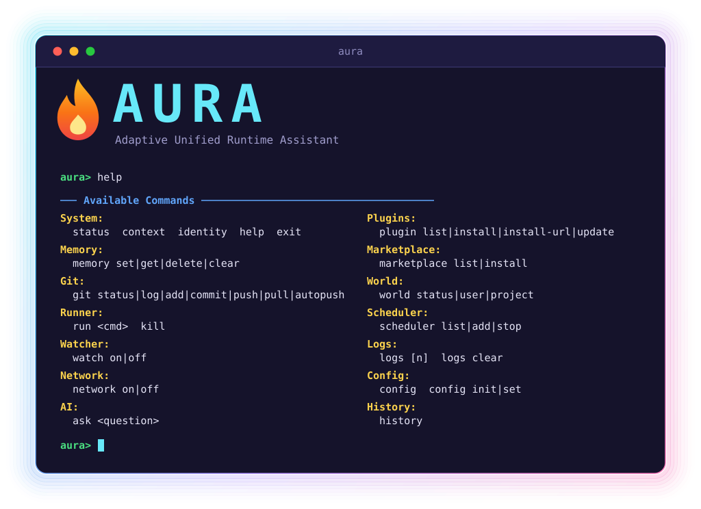

<p align="center">
  
</p>

<h1 align="center">AURA</h1>

<p align="center">
  <strong>Adaptive Unified Runtime Assistant</strong><br>
  A mini OS-layer for your terminal, built for Termux.<br>
  Git, scripts, schedules, file watching and plugins from a single shell.
</p>

<p align="center">
  <a href="https://www.npmjs.com/package/aura-terminal"></a>
  <a href="https://www.npmjs.com/package/aura-terminal"></a>
  <a href="https://github.com/djunekz/aura/tags"></a>
  <a href="https://github.com/djunekz/aura/actions/workflows/ci.yml"></a>
  <a href="https://github.com/djunekz/aura/actions/workflows/codeql.yml"></a>
  <a href="LICENSE"></a>
</p>

<p align="center">
  <a href="https://nodejs.org"></a>
  
  <a href="https://github.com/djunekz/aura/stargazers"></a>
  <a href="https://github.com/djunekz/aura/issues"></a>
  <a href="CONTRIBUTING.md"></a>
  <a href="CHANGELOG.md"></a>
  <a href="https://www.conventionalcommits.org"></a>
</p>

---

## Features

- **Git manager**: `status`, `log`, `add`, `commit`, `push`, `pull` and a one-step `autopush`, executed without a shell so commit messages are never interpreted.
- **Script runner**: run npm, Python, make or any command from inside AURA and stop it with `kill`.
- **Scheduler**: start periodic tasks from the shell or from `aura.config.json`.
- **File watcher**: react to file changes in the current project.
- **Network watcher**: know when you are online before you deploy.
- **Rule-based assistant**: `ask` analyzes errors, deploys, backups and project state locally. No API key, no data leaves your device.
- **Plugins and marketplace**: install plugins from a file, a URL or the official index. AutoBackup and AutoDeploy are bundled.
- **Persistent memory, history and logs**: stored in `~/.aura`, so upgrades never erase them.
- **Project detection**: recognizes Node.js, Python, Go, Rust, PHP, Ruby, Java, Flutter, .NET and C/C++ projects.

## Installation

Requires Node.js 22.22 or newer. On Termux:

```bash
pkg install nodejs git
```

From npm:

```bash
npm install -g aura-terminal
```

From source:

```bash
git clone https://github.com/djunekz/aura
cd aura
npm install
npm start
```

## Quick start

```bash
aura
```

```text
aura> identity set Ada
aura> git autopush fix: update configuration
aura> run npm run build
aura> scheduler add Heartbeat 600
aura> ask error
```

Type `help` for the full menu, `exit` to leave. Useful flags: `aura --version` and `aura --help`.

## Commands

| Group | Commands |
|-------|----------|
| System | `status` `context` `identity` `identity set <name>` `help` `exit` |
| Memory | `memory` `memory set <key> <value>` `memory get <key>` `memory delete <key>` `memory clear` |
| Git | `git status` `git log [n]` `git add [paths]` `git commit [message]` `git push [remote] [branch]` `git pull [remote] [branch]` `git autopush [message]` |
| Runner | `run` `run <command>` `kill` |
| Watcher | `watch on` `watch off` |
| Network | `network on` `network off` |
| AI | `ask <question>` |
| Plugins | `plugin list` `plugin install <path>` `plugin install-url <url>` `plugin update <name>` |
| Marketplace | `marketplace list` `marketplace install <name>` |
| Scheduler | `scheduler list` `scheduler add <name> <seconds>` `scheduler stop [id or name]` |
| Logs | `logs [n]` `logs clear` |
| Config | `config` `config init` `config set <key> <value>` |
| World | `world status` `world user <id> <key> <value>` `world project <name> <key> <value>` |
| History | `history` |

Details and behavior of every command are in the [command reference](docs/commands.md).

## Configuration

AURA reads `aura.config.json` from the folder where it starts. Create one with `config init`:

```json
{
  "autoWatch": false,
  "autoScheduler": [
    { "name": "Heartbeat", "interval": 300 }
  ],
  "identity": "Ada",
  "theme": "default"
}
```

State (memory, history, logs, installed plugins) is stored in `~/.aura`. Set `AURA_HOME` to change the location. See [Configuration](docs/configuration.md).

## Plugins

A plugin is one ES module that exports a name, a version and an `init(kernel)` function:

```js
export default {
  name: 'ChangeLogger',
  version: '1.0.0',
  description: 'Writes every file change to the AURA log',

  init(kernel) {
    const previous = kernel.watcher.handleEvent.bind(kernel.watcher)

    kernel.watcher.handleEvent = (event, filepath) => {
      if (event === 'change') kernel.logger.info(`changed: ${filepath}`)
      previous(event, filepath)
    }
  },
}
```

Plugins are not sandboxed, so only install code you trust. Read the [plugin guide](docs/plugins.md) for the API, testing and marketplace submission.

## Documentation

| Guide | Topic |
|-------|-------|
| [Getting started](docs/getting-started.md) | Install, first run, data location |
| [Command reference](docs/commands.md) | Every command |
| [Configuration](docs/configuration.md) | Config file, environment, state files |
| [Plugins](docs/plugins.md) | Write, test and publish plugins |
| [Architecture](docs/architecture.md) | Modules and startup sequence |
| [Troubleshooting](docs/troubleshooting.md) | Common problems |
| [Development](docs/development.md) | Tests, CI and releases |

## Contributing

Contributions are welcome. Read [CONTRIBUTING.md](CONTRIBUTING.md) first, then open an issue or a pull request. Please follow the [Code of Conduct](CODE_OF_CONDUCT.md). To report a vulnerability, see [SECURITY.md](SECURITY.md).

Every user-facing change is recorded in the [changelog](CHANGELOG.md).

## License

[MIT](LICENSE) © 2026 djunekz
