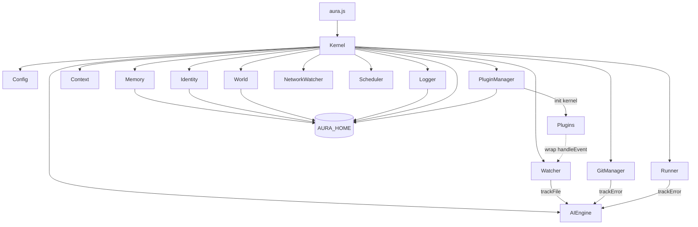

# Architecture

AURA is a small Node.js application written as ES modules. A single `Kernel` object owns the interactive shell and wires the other modules together.

## Modules

| File | Responsibility |
|------|----------------|
| `aura.js` | Entry point. Handles `--version` and `--help`, prints the banner and starts the kernel |
| `core/kernel.js` | Command parsing and dispatch, readline prompt, tab completion, history, startup and shutdown |
| `core/config.js` | Reads and writes `aura.config.json` in the working folder |
| `core/paths.js` | Resolves `AURA_HOME` and creates it |
| `core/safe.js` | Rejects keys that could pollute object prototypes |
| `core/memory.js`, `identity.js`, `world.js` | JSON-backed state in `AURA_HOME` |
| `core/logger.js` | Appends to `aura.log` and trims it |
| `core/context.js` | Detects the project type from marker files |
| `core/git.js` | Git commands run with `execFile`, no shell |
| `core/runner.js` | Runs a shell command with inherited output, one at a time |
| `core/scheduler.js` | Interval tasks |
| `core/watcher.js` | File watching through chokidar |
| `core/network.js` | Connectivity polling through `is-online` |
| `core/ai.js` | Rule-based analysis of kernel state and errors |
| `core/plugin.js` | Plugin loading, installation and marketplace access |
| `core/plugins/` | Bundled plugins: AutoBackup and AutoDeploy |
| `marketplace/plugins.json` | Index of installable plugins |
| `scripts/` | Repository tooling: marketplace validation and changelog handling |

## Startup sequence

1. `aura.js` handles flags, prints the banner and calls `new Kernel()`.
2. The constructor creates every component and loads command history.
3. `init()` loads plugins and starts the network watcher with console output muted, then starts the watcher if `autoWatch` is set, applies the configured identity and starts `autoScheduler` tasks.
4. `startCLI()` opens the readline prompt.
5. Each line is recorded in history and the log, then passed to `handleCommand`. Errors thrown by a command are caught, shown and logged.
6. `exit` or end of input calls `shutdown()`, which stops the assistant timer, scheduler, watchers and any running process.

## Design notes

- State is stored in `AURA_HOME`, not in the package folder, so upgrades never overwrite user data.
- Timers are unreferenced where possible so they never keep the process alive on their own.
- Git commands receive an argument array instead of a command string, which removes shell injection.
- Plugins extend AURA by wrapping methods on the kernel's components. This is simple but means the order of plugins matters.
- `core/dashboard.js` is an unfinished experiment for a separate dashboard process. It is not wired into the kernel and its child script does not exist.
